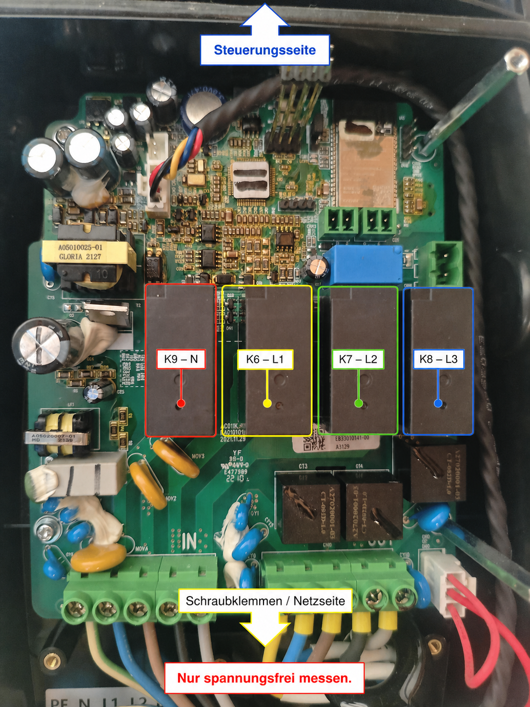

# AC011K WARP PhaseSwitch

An older AC011K-AE-25 can charge on N+L1, then switch to three phases when more
power is available. This fork makes that work on the tested 2021 V1 board:
Home Assistant supplies a power limit, the ESP32 handles the transition, and a
small GD32 patch selects the relay closing sequence.

The useful range starts at **1.38 kW on one phase** and reaches **11.04 kW on
three phases**. Both directions were tested with a CP simulator, separate lamp
loads and an MG4. Compatibility is specific to the board and GD image below.

## Read this first

- [Hardware, capabilities and project background](extras/ac011k-phase-switch/README.md)
- [Architecture and charging permission](extras/ac011k-phase-switch/ARCHITECTURE.md)
- [Build, installation and recovery](extras/ac011k-phase-switch/INSTALLATION.md)
- [MQTT, Home Assistant and migration](extras/ac011k-phase-switch/HOME_ASSISTANT.md)
- [Tests and troubleshooting](extras/ac011k-phase-switch/TESTING.md)
- [How the GD32 relay patch was found](extras/ac011k-phase-switch/REVERSE_ENGINEERING.md)
- [September ESP32/MQTT review](extras/ac011k-phase-switch/REVIEW_2026-09.md)

The September changes have host regression coverage and an ESP32 build. That
is separate from physical acceptance of the new firmware; see the test page
for the remaining checks and the working plan for deployment status.

## Project owner's notice

Please note that while tested, the whole Project was done with AI. I take no responsibility if you damage your Wallbox or simular. I kinda Supervised the AI but I cant't tell if Codex has done weird things.

## Where this comes from

This is a fork of [WARP More](https://github.com/warp-more-hardware/esp32-firmware),
which adapts Tinkerforge's WARP firmware to additional hardware. The existing
web interface, API, MQTT bridge, discovery infrastructure and GD updater are
community work; this project extends the AC011K control path.

Use [this fork's issue tracker](https://github.com/Allcrafter1/ac011k-warp-phase-switch/issues)
for its phase-switching changes. Please do not direct support requests for
modified AC011K hardware to Tinkerforge. The original [WARP README](README.rst)
and [community build notes](software/README.md) remain available.
