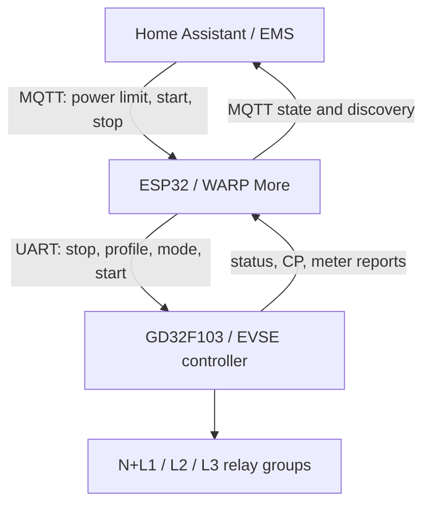

# From a power limit to a charging session

The ESP32 is the network and orchestration layer. The GD32 retains the normal
CP, PWM, fault and opening logic. The UART link uses EN+ frames with command,
sequence, length and CRC; it is not a second MQTT connection.

## Permission and power are different

`evse/power_target_update` sets a limit. It does not grant a new charging
session. The effective current is the minimum of all active charging slots:
hardware limits, global setting, start/stop release, external limit and any
enabled user/charge-manager/OCPP constraints.

The start/stop release lives in slot 4. With autostart **off**, a Start command
releases the currently connected vehicle, Stop clears that release, and
unplugging clears it again. Session slots marked `clear_on_disconnect` are
also cleared on ESP boot, so a persisted snapshot cannot resurrect a session.
New installations default to manual release. Existing explicit autostart
settings are retained; turn autostart off when every connection should require
a deliberate Start.

A vehicle pausing in `Suspended EV` is not an unplug. Clearing permission on
every pause would break scheduled or solar charging. The September incident
was a genuine unplug/replug with autostart enabled; it did not require a GD32
change. Stop and unplug must also prevent the ESP's bounded phase-switch
restart attempts from bypassing the release slots.

## A phase change

The ESP requests a stop, requires a new raw CP-B report after that request,
waits the configured off interval, sends the GD mode and reads its marker,
sends the matching charging profile, then restarts only if the vehicle is
still connected and all current limits permit at least 6 A.

| Stage | Value | What it waits for |
|---|---:|---|
| Idle | 0 | A different requested phase count |
| Stopping | 1 | Logical stop and fresh CP-B proof, at most 30 s |
| Off delay | 2 | CP release remains valid, minimum off time, current check |
| Applying | 3 | GD mode acknowledgement/readback, at most 20 s |
| Confirming | 4 | Charging-profile acknowledgement, at most 20 s |
| Restarting | 5 | Charging state; bounded attempts |
| Restart pause | 6 | 1.5 s pause before another permitted attempt |
| Error | 7 | An explicit new request; no ordinary start bypass |

GD logical status is not physical proof that the contacts opened. The lamp
tests demonstrated this directly. The raw CP guard therefore stays in place.
A missing report must be diagnosed, not treated as permission to switch.

For one-phase operation, the final GD close marker and measured currents
provide additional checks. `physically_verified` is a verification result,
not a contact-voltage instrument. Likewise, the legacy `active_phases` field
is the last phase verification result and may remain nonzero while idle.
Use the live per-phase current sensors to see actual current flow.

## Measurements and limitations

GD report 0x08 supplies total power, energy counters, three voltages, three
currents and charging duration. Voltages and currents are decoded in 0.1 V/A
steps. The existing `meter/all_values` array stores voltages at indices 0–2
and currents at 3–5; many later entries remain unsupported zero placeholders.
They must not become apparently valid HA sensors.

The relative energy sensor is a software-accumulated counter, not simply the
energy of the latest session. Counter persistence/restart reconstruction is
inherited community behavior and can lose recent increments on abrupt power
loss. Use an independent meter for billing. Raw temperature/leakage fields
appear in protocol logs, but their conversion and semantics are not validated
here, so discovery does not invent units for them.
